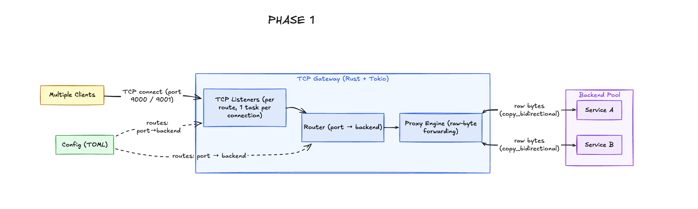
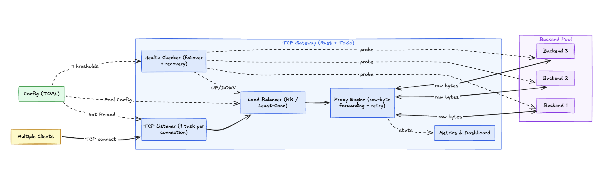

# RustyCoders

Code Repository for RustyCoders

## MVP Architecture



## High Level Architecture

This project implements a **Layer-4 TCP Traffic Gateway** in **Rust + Tokio**, acting as an intermediary between clients and backend servers. The gateway accepts incoming TCP connections, selects a healthy backend using configurable load-balancing strategies, and forwards raw bytes bidirectionally without inspecting application-layer data.



### Key Components

- **TCP Listener** – Accepts incoming client connections and spawns an async task for each connection.
- **Load Balancer** – Selects a backend using **Round Robin** or **Least Connections**, considering only healthy servers.
- **Proxy Engine** – Establishes backend connections and performs raw-byte TCP forwarding with retry/failover support.
- **Health Checker** - Continuously monitors backend availability using active probes and passive failure detection.
- **Backend Pool** – Maintains backend metadata such as health status, active connections, and routing eligibility.
- **Hot Reload** – Atomically swaps backend pools on SIGHUP signal using lock-free ArcSwap, without dropping connections.
- **Metrics & Dashboard** – Provides observability through connection statistics, backend health, traffic metrics, and system events.
- **TOML Configuration** – Controls gateway behavior, backend definitions, thresholds, and load-balancing settings without code changes.

### Architectural Note: L4 Failover Limitation

> **Note:** Failover applies at **connection establishment time** only. If a selected backend refuses or times out during the initial TCP handshake, the gateway transparently retries a different healthy backend — the client never sees a failure.
>
> However, because this is an **L4 (TCP) proxy**, if a backend dies **mid-stream** (after bytes have already started flowing), the connection is closed cleanly. We cannot transparently replay a TCP byte stream to another backend because the protocol state (sequence numbers, application context) has already been established. This is a fundamental limitation of Layer-4 proxying — Layer-7 (HTTP) proxies can retry mid-stream because they understand request boundaries.

---

## Features

| Feature | Description |
|---|---|
| Round-Robin Load Balancing | Even distribution across healthy backends |
| Least-Connections Balancing | Routes to the backend with fewest active connections |
| Active Health Checks | Background TCP probes detect down backends without traffic |
| Passive Health Detection | Connection failures during proxying trigger health transitions |
| Auto-Recovery | Revived backends are automatically detected and re-added to rotation |
| Connect-Time Failover | Failed backend connections are transparently retried on another backend |
| Hot Config Reload | Edit `gateway.toml` and send `SIGHUP` — backends and strategy swap live, zero downtime |
| RAII Connection Counting | `ConnectionGuard` ensures accurate active counts even on crashes or `kill -9` |
| Graceful Shutdown | `Ctrl-C` triggers clean shutdown via `CancellationToken` |
| Live Dashboard | Metrics logged every 10s: active/peak/total connections, CPS, per-backend health |

---

## Quick Start

### 1. Build

```bash
cargo build --release
```

### 2. Start Backend Servers

```bash
./target/release/echo_server 9001 &
./target/release/echo_server 9002 &
./target/release/echo_server 9003 &
```

### 3. Configure (`gateway.toml`)

```toml
[global]
max_connections = 1000

[[listeners]]
name = "service-a"
listen = "127.0.0.1:8080"
backends = ["127.0.0.1:9001", "127.0.0.1:9002", "127.0.0.1:9003"]
strategy = "round_robin"
connect_timeout_ms = 1000

[listeners.health_check]
enabled = true
interval_ms = 2000
timeout_ms = 500
healthy_threshold = 2
unhealthy_threshold = 3
```

### 4. Run the Gateway

```bash
cargo run --release --bin traffic_gateway
```

### 5. Send Traffic

```bash
echo "hello" | nc -w 1 127.0.0.1 8080
```

### 6. Hot Reload (Zero Downtime)

Edit `gateway.toml` to add/remove backends or change strategy, then:

```bash
kill -HUP $(pgrep traffic_gateway)
```

The gateway atomically swaps to the new config. Existing connections are unaffected. If the new config is invalid, the old config is kept and an error is logged.

---

## Project Structure

```
src/
  main.rs              — Entry point: config loading, listener spawning, SIGHUP handler
  config.rs            — TOML config parsing with validation
  listener.rs          — TCP accept loop with per-connection async tasks
  reload.rs            — Atomic config reload logic (ArcSwap)
  metrics.rs           — Connection counters and dashboard
  lib.rs               — Module exports
  proxy/
    connection.rs      — Bidirectional TCP byte forwarding
  backend/
    pool.rs            — Round-Robin and Least-Connections selection
    instance.rs        — Backend state machine (health, RAII guards)
    health.rs          — Active TCP health check probes
  bin/
    echo_server.rs     — Simple echo backend for testing
    echo_identity.rs   — Echo backend that identifies itself (for routing tests)
    loadtest.rs        — Persistent-connection load generator with p50/p95/p99

tests/
  integration.rs       — 31 automated tests (unit + integration + chaos)

testing/
  phase2_verification_report.md — Full test results and benchmark data
```

---

## Testing

### Run All Tests

```bash
cargo test
```

**31 tests** covering:
- Data model and health state transitions (8 tests)
- Load balancing algorithms (7 tests)
- End-to-end routing, byte integrity, and cross-talk prevention (10 tests)
- Failover and all-backends-down scenarios (2 tests)
- Active health check detection and auto-recovery (2 tests)
- Chaos testing: kill and revive backends under live traffic (2 tests)

### Run Benchmarks

```bash
cargo run --release --bin loadtest -- --connections 100 --duration 10
```

Benchmark results (Apple Silicon, localhost, 3 backends):

| Concurrency | Req/sec | p50 Latency | Error Rate |
|---|---|---|---|
| 100 | 111,428 | 883us | 0.00% |
| 500 | 110,012 | 4.5ms | 0.00% |
| 1,000 | 107,237 | 9.1ms | 0.00% |

---

## Hot Reload — How It Works

The gateway uses [ArcSwap](https://docs.rs/arc-swap) to wrap each `BackendPool` in an atomically swappable container.

1. You edit `gateway.toml` (add/remove backends, change strategy)
2. You send `kill -HUP $(pgrep traffic_gateway)`
3. The gateway re-reads and validates the config using the same validation as startup
4. If valid: atomically swaps the pool — new connections use new config instantly
5. If invalid: logs an error and keeps the old config running safely
6. Existing connections are never dropped — they hold a reference to the old pool until they finish naturally

**Scope:** Hot reload supports changing backends, strategy, and health check thresholds for existing listeners. Adding or removing listeners (new listen ports) requires a gateway restart.

---

## Lines of Code

| Component | Lines |
|---|---|
| Backend Pool & Health | 536 |
| Listener & Proxy | 259 |
| Config & Reload | 222 |
| Main & Metrics | 220 |
| Binaries (echo, loadtest) | 425 |
| Integration Tests | 791 |
| **Total** | **2,459** |

---

## Tech Stack

- **Language:** Rust (2021 edition)
- **Async Runtime:** Tokio (full features)
- **Atomic Swapping:** ArcSwap
- **Config:** TOML (serde)
- **Logging:** tracing + tracing-subscriber
- **Error Handling:** anyhow
